<div align="center">


<br/>


<br/>


<br/>


<br/><br/>


<br/><br/>

**AI & Data Science graduate** (B.E., PVG College of Engineering, SPPU, 2026) who turns raw data into clear answers.<br/>
I build with **Python** and **SQL**, ship small full-stack tools, and design dashboards people can actually read.

```sql
SELECT * FROM devendra WHERE open_to_work = TRUE;  -- 1 row returned
```

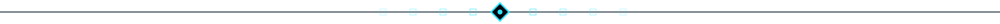




<a href="https://github.com/devs901/GramSathi"></a>
<br/><br/>

<br/><br/>

<a href="https://github.com/devs901?tab=repositories"></a>
<br/><br/>

<br/><br/>


<a href="https://github.com/devs901/spendwise-expense-tracker"></a>
<br/><br/>


<br/><br/>





<br/><br/>






<br/>

<a href="Devendra_Rathod_CV.pdf"></a>


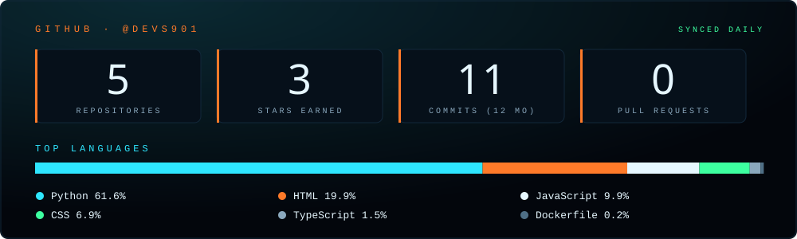

<br/><br/>


<!-- OPTIONAL: contribution snake. See SETUP.md, then uncomment.
<br/><br/>
<picture>
  <source media="(prefers-color-scheme: dark)" srcset="https://raw.githubusercontent.com/devs901/devs901/output/github-snake-dark.svg"/>
  
</picture>
-->


<a href="https://www.linkedin.com/in/devendra-rathod-891795266"></a>&nbsp;
<a href="mailto:dev901rathod@gmail.com"></a>&nbsp;
<a href="https://github.com/devs901"></a>

<br/><br/>


</div>
